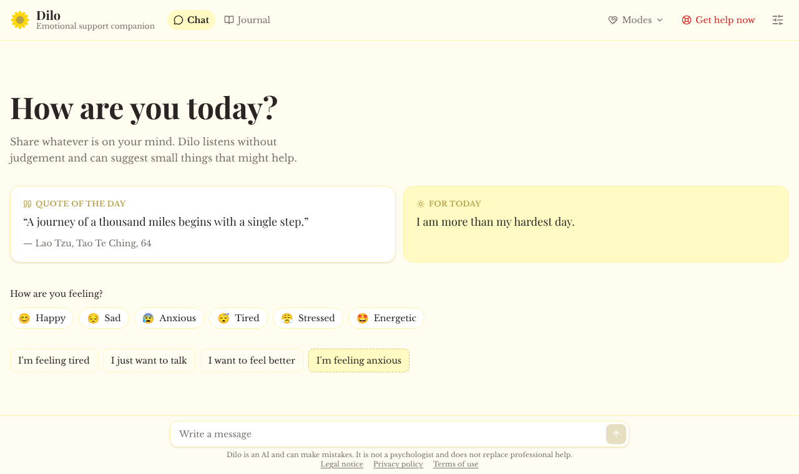
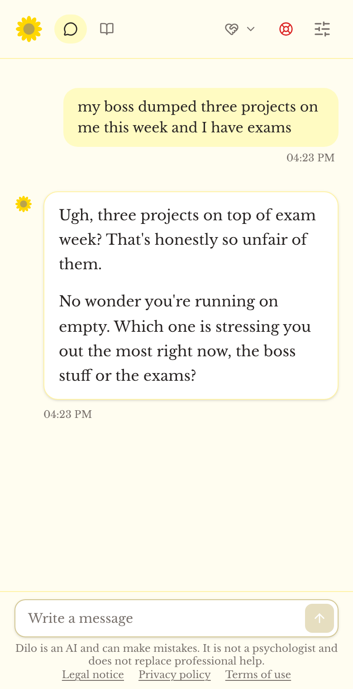
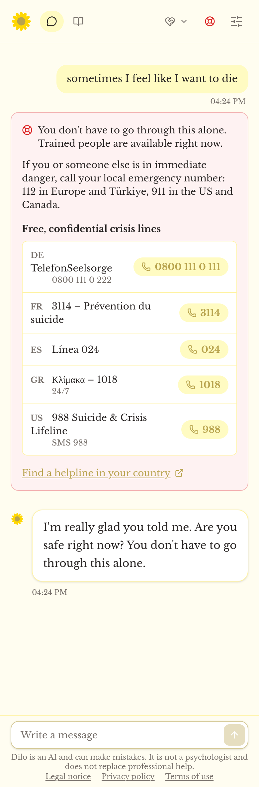
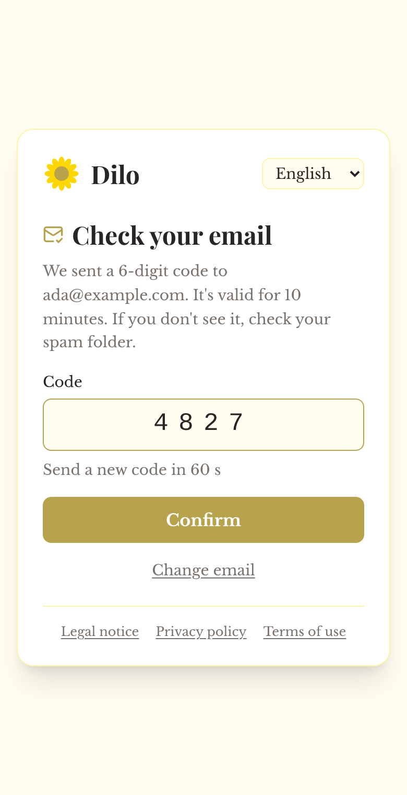
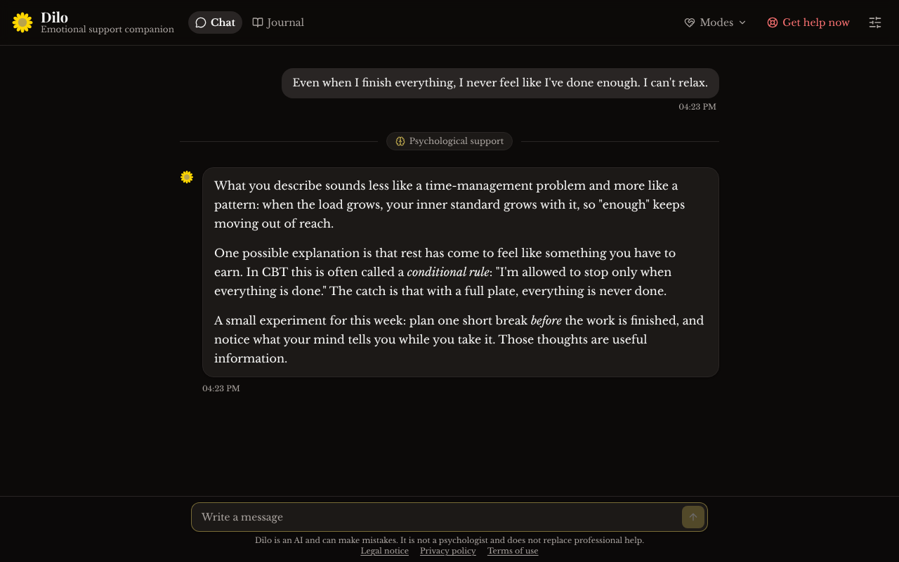
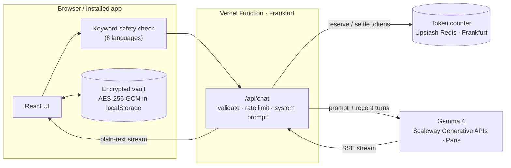

# Dilo – AI Emotional Support Companion


**Dilo is a private AI companion for emotional wellbeing.** It listens without judgement, talks like a warm friend or uses methods from psychology, keeps an encrypted journal on your device, and points you to real, human help the moment a conversation signals risk.

**Live:** [dilo-ai-emotional-support-companion.vercel.app](https://dilo-ai-emotional-support-companion.vercel.app) · installable as an app · 8 languages · for adults (18+)

> Dilo is not a psychologist or therapist and does not replace professional help.

<p align="center">
  
</p>

<table>
  <tr>
    <td width="33%"></td>
    <td width="33%"></td>
    <td width="33%"></td>
  </tr>
  <tr>
    <td align="center"><sub>Friend mode</sub></td>
    <td align="center"><sub>Safety net, independent of the AI</sub></td>
    <td align="center"><sub>Email confirmed with a 6-digit code</sub></td>
  </tr>
</table>

<p align="center">
  
  <br><sub>Psychological support mode (dark theme), with a divider where the style changed mid-conversation</sub>
</p>

## What it does

- **Two clearly different ways to talk.** *Friend* sounds like an affectionate best friend: casual, on your side, comfort before advice, no lists. *Psychological support* analyses carefully and goes deep, using CBT/ACT-informed methods (hypotheses, patterns, psychoeducation, small experiments) without ever claiming to be a psychologist or diagnosing. The style can be switched mid-conversation.
- **"Just listen" or "Listen and give tips"**, plus an optional mood that shapes the reply.
- **Fast on every device.** Replies stream from an EU-hosted model in about a second.
- **Encrypted journal.** Every conversation is saved and can be continued, deleted or locked with its own password. Journal entries and notes never leave the device and are never sent to the AI.
- **Device accounts with email reset.** Sign up with an email confirmed by a 6-digit code. Forgot your password? A code sent to your email sets a new one, and all your conversations stay, because the server only keeps an encrypted copy of the vault's key, never the vault.
- **Safety by design.** Crisis lines appear under any message that signals risk, from a keyword check in 8 languages that works even when the AI fails. A conversation in which someone states an intent to hurt another person is closed for good, with emergency numbers.
- **Quote and affirmation of the day** from documented, public-domain sources.
- **Installable app (PWA)** with offline access to the journal, light/dark themes, three text sizes, and right-to-left layouts for Arabic and Persian.
- **Built for the EU.** Blocking consent screen (18+, not a professional service, explicit consent for health-related data), legal pages in German and English, one-click "delete everything and withdraw consent". No cookies, trackers or analytics.

## Architecture



Only the current conversation leaves the device, and only to generate a reply. Nothing is stored on the server: no database of messages, no logging of message content.

## Engineering decisions

**Password reset by email without giving up end-to-end privacy.** Each account's vault is encrypted on the device with a random 256-bit data key, sealed under a key derived from the password (PBKDF2, 310,000 iterations). To let users reset a forgotten password without losing data, the server keeps a copy of only the data key, encrypted with a server secret and stored under an HMAC of the email address. The vault never leaves the device, so neither side alone can read anything. Emailed codes are stored only as HMACs, expire after 10 minutes, allow 5 attempts, and are rate-limited per email, per IP and per day; a reset request for an unknown address looks exactly like a real one, so nobody can find out who uses Dilo. (`server/auth.ts`, `src/lib/accounts.ts`)

**A safety net that doesn't depend on the model.** A deterministic keyword check runs on every message before anything is sent, in 8 languages, including Greek without accents and Greeklish. It is deliberately conservative where a false positive is costly: closing a conversation requires explicit first-person intent toward another person ("I'm going to kill him"), not figures of speech ("my mum will kill me") or self-harm, which keeps the conversation open and shows crisis lines instead. The model adds a second layer through `[CRISIS]` and `[HARM]` markers, and the server refuses any conversation the client should have closed. (`src/lib/crisisDetect.ts`, `server/chat.ts`)

**Never paying for usage by accident.** Before each request, the server atomically reserves the worst-case token cost on a shared counter, then settles it with the real usage reported in the stream. Concurrent requests can't overshoot the budget, and if the counter is unavailable the server fails closed instead of calling the model. (`server/chat.ts`)

**Prompting for two distinct voices.** The system prompt is assembled from mode, support style, mood and language, with explicit rules against stock phrases, repetition and unrequested advice. Real-model testing showed that small models copy example sentences and that hidden reasoning could use up the whole reply budget on long messages, so examples were removed, reasoning is disabled, and near-duplicate replies are detected and regenerated. (`src/lib/prompt.ts`, `src/lib/api.ts`)

**Streaming end to end.** The function converts the provider's SSE stream into a plain-text stream, and the UI follows new text only while the user is at the bottom, so scrolling up to reread is never interrupted.

## Tech stack

| Layer | Technology |
|-------|-----------|
| UI | React 19, TypeScript (strict), Tailwind CSS 4, self-hosted fonts |
| Build | Vite 6, PWA (manifest + service worker) |
| Server | Vercel Function (`api/chat.ts`, Frankfurt), web-standard `Request`/`Response` |
| AI | Gemma 4 on Scaleway Generative APIs (Paris), OpenAI-compatible, streamed |
| Storage | Encrypted vaults in `localStorage`; token counter, email codes and key copies in Upstash Redis (Frankfurt) |
| Email | Gmail via nodemailer (codes in 8 languages); Brevo API as an alternative |
| Crypto | Web Crypto API (PBKDF2-SHA-256, AES-256-GCM) |
| Tests | Vitest (140 unit tests) |

## Project structure

```
api/chat.ts                 Vercel Function entry point
server/chat.ts              validation, rate limiting, token budget, provider call, streaming
server/auth.ts              email codes, key copies for password reset, rate limits
src/App.tsx                 consent → account → chat / journal
src/components/             ChatMessage, Composer, JournalView, AccountGate, EmailResetSetup, DailyCard, ...
src/lib/prompt.ts           system prompt, safety markers
src/lib/crisisDetect.ts     keyword safety net (8 languages)
src/lib/accounts.ts         device accounts, data keys, password reset
src/lib/lock.ts             PBKDF2 + AES-GCM helpers, password rules
src/lib/daily.ts            quote and affirmation of the day
src/lib/legal.ts            Impressum, privacy policy, terms (de/en)
public/sw.js                service worker (never caches /api/)
tests/                      unit tests
```

## Run locally

```bash
npm install
cp .env.example .env.local   # add AI_API_KEY
npm run dev                  # http://localhost:3000  (add ?mockAI to try the UI without a key)
```

On Windows PowerShell, if scripts are blocked, use `npm.cmd` instead of `npm`.

```bash
npm run lint         # TypeScript, strict mode
npm test             # unit tests
npm run check:legal  # legal details filled in
npm run build
```

## Deploy (Vercel + Scaleway)

1. Create a Scaleway API key: console → **IAM** → **API keys** → **Generate API key**, and copy the **secret key**.
2. In Vercel → **Settings → Environment Variables**, add `AI_API_KEY` with the secret key.
3. In Vercel → **Storage**, add **Upstash for Redis** (free plan, Frankfurt) and connect it. This adds `KV_REST_API_URL` and `KV_REST_API_TOKEN`. Dilo then stops at 900,000 tokens (`AI_TOKEN_BUDGET`) and shows "Dilo is taking a break" instead of creating costs.
4. Email codes: add `GMAIL_USER` and `GMAIL_APP_PASSWORD` (a Google app password) in Vercel. Brevo works too (`BREVO_API_KEY`, `MAIL_FROM`).
5. Optional: `AI_MODEL` (default `gemma-4-26b-a4b-it`) and `AI_BASE_URL` (default `https://api.scaleway.ai/v1`).
6. Fill in `src/lib/operator.ts` for the Impressum and have the legal texts reviewed by a lawyer.

## The story behind it

Dilo's name comes from my cousin **Dilvin**, a psychology student who has always shown up for the people around her, especially on hard days. Her empathy and patience inspired every design decision in this app. I wanted to build something that carries even a small piece of what she naturally gives to everyone around her.

> Mental health support shouldn't feel clinical or out of reach. Dilo exists to bridge that gap.

## Roadmap

- [x] Crisis resources and an AI-independent safety net
- [x] EU-hosted AI with streamed replies
- [x] Encrypted device accounts with password reset by email
- [x] Installable app with quote and affirmation of the day
- [ ] Opt-in daily check-in notifications
- [ ] End-to-end encrypted sync across devices
- [ ] Response guidelines reviewed by a psychologist

## Author

**Ada Alkım Açıkyol**, Software Engineering student and co-founder & CPO of Taply.
